# hiWBC: A Unified Whole-Body Control Layer for Humanoid Robots

<div align="center">

**Author:** [The Humanoid Intelligence Team](https://humanoidintelligence.github.io)

[OpenMOSS Group](https://openmoss.ai) / [Shanghai Innovation Institute](https://www.sii.edu.cn/) / [Fudan University](https://www.fudan.edu.cn/en/)

English | [简体中文](./README.zh-CN.md)

<!-- controller-gallery:start -->

<table>
<tr><td colspan="5" align="center">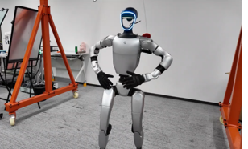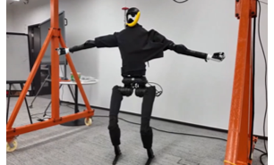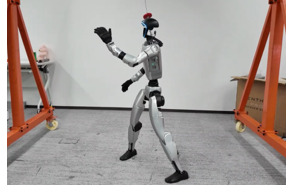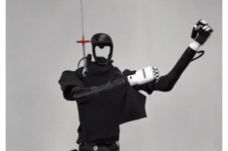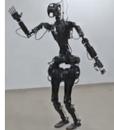</td></tr>
<tr><td align="center"><a href="docs/guides/locomotion.md#unitree_loco-unitree_rl_gym-gait">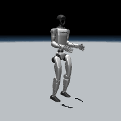</a><br><sub>unitree_loco</sub></td><td align="center"><a href="docs/guides/locomotion.md#smooth_loco">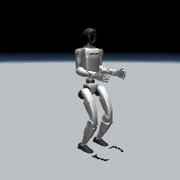</a><br><sub>smooth_loco</sub></td><td align="center"><a href="docs/guides/locomotion.md#amo_loco">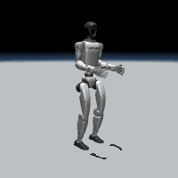</a><br><sub>amo_loco</sub></td><td align="center"><a href="docs/guides/motion_tracking.md#asap_tracker">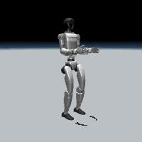</a><br><sub>asap_tracker</sub></td><td align="center"><a href="docs/guides/motion_tracking.md#beyondmimic_tracker">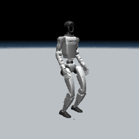</a><br><sub>beyondmimic_tracker</sub></td></tr>
<tr><td align="center"><a href="docs/guides/motion_tracking.md#twist_tracker">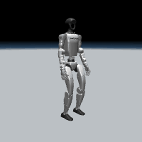</a><br><sub>twist_tracker</sub></td><td align="center"><a href="docs/guides/motion_tracking.md#kungfubot_tracker">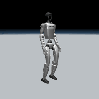</a><br><sub>kungfubot_tracker</sub></td><td align="center"><a href="docs/guides/motion_tracking.md#protomotions_tracker-h2h">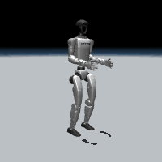</a><br><sub>protomotions_tracker</sub></td><td align="center"><a href="docs/guides/sonic.md#4-track-a-reference-motion-joint-mode"></a><br><sub>sonic</sub></td><td align="center"><a href="docs/guides/motion_tracking.md#supermimic">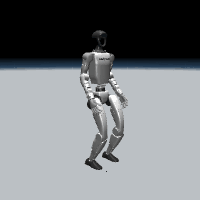</a><br><sub>supermimic</sub></td></tr>
</table>

Each clip runs in MuJoCo on the Unitree G1 through hiRobot's `wbc` layer. Click one for its guide.

<!-- controller-gallery:end -->

</div>

<!-- toc -->

<details>
<summary><b>Contents</b></summary>

- [Introduction](#introduction)
- [Supported controllers](#supported-controllers)
- [Quick start](#quick-start)
  - [Step a controller](#step-a-controller)
  - [Run it as a hiRobot robot](#run-it-as-a-hirobot-robot)
  - [Real robot](#real-robot)
- [Architecture](#architecture)
- [Repository structure](#repository-structure)
- [Add a new controller](#add-a-new-controller)
- [Contact](#contact)
- [Citation](#citation)
- [Acknowledgements](#acknowledgements)
- [License](#license)

</details>

<!-- /toc -->

## Introduction

hiWBC is the low-level **whole-body control** layer for humanoid robots. A
humanoid cannot take joint targets open-loop, or it falls. hiWBC takes a
high-level motion command (a velocity command, a reference motion, or a motion
latent) plus the current robot state, and produces balanced full-body joint
targets at the robot's real-time control rate.

A high-level model decides *what* to do; hiWBC decides *how the whole body moves*
to do it. Learned controllers, from velocity-command locomotion policies and
reference-motion trackers to the SONIC behavior foundation model, live behind one
contract, so the layers above never touch balance, locomotion, or the vendor
control loop.

- **One contract, many controllers** — write the control loop against the
  `Controller` contract and swap the policy (a locomotion policy, a motion
  tracker) without touching the robot interface.
- **Command-source agnostic** — the same contract carries a joystick velocity
  command, reference-motion frames from a motion player or VR teleoperation, or a
  motion latent from a VLA model. Where the command comes from is not the
  controller's concern.
- **Reference in, joint targets out, as a hiRobot layer** — a controller is
  `(state, reference) -> joint targets + gains`, a pure step with no hardware
  I/O, so any loop can run it. The usual one is hiRobot's: add
  `layers: [{type: wbc, profile: sonic/unitree_g1}]` to a robot config and the
  robot takes base velocities, walk-to-pose goals, hand poses, motion tokens and
  motion clips instead of joint targets. The layer runs the controller at the
  control rate, stands still when commands stop, and damps the robot on any
  fault. The model forward can run on a workstation while the control loop stays
  on the robot.
- **Step-by-step deployment docs** — deploying a whole-body controller on a real
  humanoid involves many details a newcomer can't guess, so the
  [guides](docs/guides/README.md) cover each released policy: checkpoint
  loading, joint order, the parameters it was trained with, gains and default
  pose, the reference it needs, first power-on with the robot supported, and
  common pitfalls.
- **Decoupled by design** — controllers sit flat in `controllers/`, one per
  file, registered by name; the values each checkpoint was trained with live
  apart from the code, in one profile per `<controller>/<robot>`. The model
  forward is injected, so observation logic is tested with a stub and no
  weights, and torch / onnxruntime are optional extras imported only where a
  checkpoint is loaded. A new checkpoint of a supported policy is a profile
  variant; a new controller is one file, its profile and its tests, with no
  change to the layer or to hiRobot.

> [!NOTE]
> **Companion projects.** [hiRobot](https://github.com/humanoidintelligence/hiRobot)
> (the body) is the robot interface hiWBC plugs into as a layer,
> [hiVLA](https://github.com/humanoidintelligence/hiVLA) (the motor cortex) serves the VLA
> models that produce high-level commands, and
> [hiAgent](https://github.com/humanoidintelligence/hiAgent), the agentic operating layer,
> drives the robot from above; it talks to hiRobot, never to hiWBC directly. hiWBC needs
> hiRobot for its layer and types; the controllers themselves import only numpy and can be
> stepped from any loop.

> [!WARNING]
> **Status — early development.** APIs are unstable and subject to change.
>
> **Safety on real robots.** A robot under software control can injure people and
> damage itself. Read this repository carefully before running it on hardware,
> and hiRobot's [setup guide](https://github.com/humanoidintelligence/hiRobot/tree/main/docs/setup)
> for your robot. Real-robot testing so far covers the policies
> [RoboJuDo](https://github.com/HansZ8/RoboJuDo) deploys (`unitree_loco`, `smooth_loco`,
> `amo_loco`, `asap_tracker`, `twist_tracker`, `beyondmimic_tracker`, `kungfubot_tracker`,
> `protomotions_tracker`): we tested them on a real robot earlier, and for this release
> compared each hiWBC controller with RoboJuDo tick for tick in MuJoCo. This release
> itself, including `sonic`, `supermimic` and the `wbc` layer, has been run in
> simulation only.
> Debug in simulation until it works, then move to the real robot step by step:
> read-only first, then the robot hung on a gantry at low gains, with an e-stop
> within reach and nobody inside the robot's reach. On hardware the `wbc` layer
> ramps to the controller's default pose before handing over, holds a stand when
> commands stop, and damps on faults ([guide](docs/guides/robot.md)); none of that
> replaces the gantry and the e-stop.

## Supported controllers

The built-in controllers are grouped by what they are commanded with. Each
one reproduces the observation layout its policy was trained with, following the
deployment code in [RoboJuDo](https://github.com/HansZ8/RoboJuDo). Observation
field order is safety-critical: a policy fed a reordered observation commands the
robot with garbage, so the tests pin every layout.

**Velocity-command locomotion** — `ReferenceKind.VELOCITY`, `value = [vx, vy, wyaw]`:

| Controller | Policy | Observation |
| --- | --- | --- |
| `unitree_loco` | [unitree_rl_gym](https://github.com/unitreerobotics/unitree_rl_gym) (gait) / [unitree_rl_lab](https://github.com/unitreerobotics/unitree_rl_lab) (`with_gait=False`) | ang vel, projected gravity, command, joint pos / vel, last action, gait-phase sin/cos |
| `smooth_loco` | [Smooth Humanoid Locomotion](https://github.com/zixuan417/smooth-humanoid-locomotion) | gait sin/cos, command, ang vel, roll / pitch, joint pos / vel, last action, privileged-latent slot, proprio history |
| `amo_loco` | [AMO](https://github.com/OpenTeleVision/AMO) | velocity plus base height and torso yaw / pitch / roll (`value` has 7 entries); an adapter MLP, a demo term, proprio history, and a second input of 25 proprio frames. Observes 23 G1 joints, drives 15 |

**Reference-motion tracking** — `ReferenceKind.MOTION_FRAMES`, terms in `frames`:

| Controller | Policy | Reference terms (`frames`) |
| --- | --- | --- |
| `asap_tracker` | [ASAP](https://github.com/LeCAR-Lab/ASAP) | none; the motion is baked into the checkpoint and advanced by an internal phase clock |
| `twist_tracker` | [TWIST](https://github.com/YanjieZe/TWIST) | `mimic_target` |
| `beyondmimic_tracker` | [BeyondMimic](https://github.com/HybridRobotics/whole_body_tracking) | `command`, `motion_anchor_ori_b`, plus `motion_anchor_pos_b` and `base_lin_vel` unless `without_state_estimator=True` |
| `protomotions_tracker` | [ProtoMotions](https://github.com/NVlabs/ProtoMotions) | `task_obs` |
| `kungfubot_tracker` | [KungfuBot / PBHC](https://github.com/TeleHuman/PBHC) | `anchor_ref_rot`, `next_step_ref_motion`, `future_motion_*`; the model takes three inputs, so `observe` returns a tuple |
| `supermimic` | SuperMimic, unofficial reproduction ([supermimic_deploy](https://github.com/KyrieYoung926/supermimic_deploy), Unitree G1) | `goal`: `(T, 68)` future goal frames from `goal_features`; `SuperMimicController.from_bundle(assets_dir)` loads the bundle's `config.json` and `policy.onnx` |

**Universal motion token** — `ReferenceKind.LATENT` or `ReferenceKind.MOTION_FRAMES`:

| Controller | Policy | Reference |
| --- | --- | --- |
| `sonic` | [GEAR-SONIC](https://github.com/NVlabs/GR00T-WholeBodyControl) (Unitree G1; `default`, `low_latency`, `sonic_v1_1`) | `LATENT`: a 64-d motion token, e.g. from a VLA. `MOTION_FRAMES`: future frames for the `g1`, `teleop` (VR 3-point) or `smpl` encoder mode, which the encoder turns into a token. `VELOCITY`: through NVIDIA's locomotion planner, optionally with hand targets |

SONIC is two models: an encoder maps the reference to a motion token, and a
decoder maps the token plus 10 ticks of proprioception history to joint actions.
`sonic` follows the observation layout of NVIDIA's C++ deployment and the
`observation_config.yaml` of each released checkpoint. It returns the
deployment's per-joint PD gains with each target.
`SonicController.from_onnx(decoder_path, encoder_path)` loads the released ONNX
files (requires the `onnx` extra). To walk on a velocity command, the
`sonic/unitree_g1` profile adds the kinematic planner from the same release, as
NVIDIA's deployment does: the planner predicts lower-body motion from the
command and SONIC tracks it.

The trackers consume reference terms for the current tick. `ClipPlayer`
(`hiwbc.references`) turns a hiRobot `MotionClip` into those terms for `sonic`,
`twist_tracker` and `supermimic`; ASAP and BeyondMimic checkpoints play the
motion trained into them as a behavior. `kungfubot_tracker` and
`protomotions_tracker` also take clips: their profiles compute the terms that
need forward kinematics (KungfuBot's key-body positions, H2H's imitation
observation) with hiRobot's kinematics.

`echo` is a dependency-free stub that accepts every reference kind and returns the
default pose. It exercises the contract end to end without a model.

The [guides](docs/guides/README.md) show how to run each controller with its
released checkpoint: [getting started](docs/guides/getting_started.md),
[locomotion](docs/guides/locomotion.md),
[motion tracking](docs/guides/motion_tracking.md), [SONIC](docs/guides/sonic.md), and
[running a controller as a hiRobot robot](docs/guides/robot.md).
Their parameters were checked tick for tick against RoboJuDo (SONIC: NVIDIA's
C++ deployment) in MuJoCo.

## Quick start

The core depends on numpy and hiRobot; install hiRobot first if pip cannot find
it. Extras add what a checkpoint needs:

```bash
git clone https://github.com/humanoidintelligence/hiWBC.git && cd hiWBC
pip install -e .                 # core: contract + controllers
# extras: torch (TorchScript checkpoints) · onnx (ONNX checkpoints, e.g. SONIC) · dev (pytest, ruff)
python -m pytest                 # policies are stubbed; no GPU or weights needed
```

Start with a controller on its own, then run it as a hiRobot robot in MuJoCo,
and only then move to hardware.

### Step a controller

A controller is a pure step, so it runs without a robot. With a stub forward
function (no weights):

```python
import numpy as np
from hiwbc import ControllerState, Reference, ReferenceKind, make_controller

n = 12  # joints, in the policy's training order
ctrl = make_controller(
    "unitree_loco",
    num_actions=n,
    default_pos=np.zeros(n),
    forward_fn=lambda obs: np.zeros(n, dtype=np.float32),  # stands in for a checkpoint
)
state = ControllerState(
    dof_pos=np.zeros(n), dof_vel=np.zeros(n),
    base_quat=np.array([0.0, 0.0, 0.0, 1.0]),  # [x, y, z, w]
    base_ang_vel=np.zeros(3),
)
target = ctrl.step(state, Reference(kind=ReferenceKind.VELOCITY, value=np.array([0.5, 0.0, 0.0])))
target.position  # (12,) PD position target
```

To run a trained policy, pass a forward function that wraps the checkpoint. A
TorchScript export, for example:

```python
import torch

policy = torch.jit.load("policy.pt").eval()

@torch.no_grad()
def forward_fn(obs):
    return policy(torch.from_numpy(obs).unsqueeze(0)).squeeze(0).numpy()
```

An ONNX runner works the same way. With the checkpoints on disk, a profile
does all of this, with the values the policy was trained with:

```python
import hiwbc

ctrl = hiwbc.load("unitree_loco/unitree_g1", checkpoint_dir="RoboJuDo/assets/models/g1")
```

Call `ctrl.step` once per control tick (50 Hz by default for the locomotion
controllers) and `ctrl.reset()` at the start of each episode to clear the
action-smoothing buffer, phase clock and history. In practice the `wbc` layer
does this loop for you, as the next section shows.

### Run it as a hiRobot robot

Add a `wbc` layer to a hiRobot robot config and the robot takes high-level
actions instead of joint targets. The example below runs SONIC on hiRobot's
MuJoCo G1. It needs hiRobot's `sim` extra, the `onnx` extra and the SONIC
checkpoints under `~/.cache/hiwbc/sonic` (see the [SONIC guide](docs/guides/sonic.md)).

```yaml
# g1_sonic.yaml: SONIC on the MuJoCo G1
defaults: [robots/unitree_g1_mujoco_standing]   # the G1 free on the floor
assembly:
  parts:
    body:
      overrides:
        model:    # start in SONIC's standing pose (G1 SDK order)
          home: [-0.312, 0, 0, 0.669, -0.363, 0, -0.312, 0, 0, 0.669, -0.363, 0,
                 0, 0, 0, 0.2, 0.2, 0, 0.6, 0, 0, 0, 0.2, -0.2, 0, 0.6, 0, 0, 0]
sim:
  realtime: false
  ramp_seconds: 0.0
layers:
  - type: wbc
    profile: sonic/unitree_g1
    start_seconds: 0.0     # no start ramp: SONIC balances from the first tick
```

```python
import numpy as np
from hirobot import Action, ControlMode, make_robot

robot = make_robot("g1_sonic.yaml")
robot.connect()
walk = Action(mode=ControlMode.BASE_VELOCITY, base_velocity=np.array([0.4, 0.0, 0.0]))
for _ in range(250):      # 5 s at 50 Hz; in simulation each send advances one tick
    robot.send_action(walk)
robot.hold()              # stand still
robot.disconnect()
```

The G1 walks about 1.5 m forward in 5 s, then stands still. On a real robot the
layer runs its own control thread instead: the caller keeps sending, and after
0.5 s without a command (`timeout_s`) the robot stands still. The
[robot guide](docs/guides/robot.md) explains these settings and covers every
mode, faults, status and remote inference.

### Real robot

We tested the policies RoboJuDo deploys on a real robot earlier, and their hiWBC
controllers match RoboJuDo tick for tick in MuJoCo; this release, including
`sonic`, `supermimic` and the `wbc` layer, has been run in simulation only. The
same `layers:` entry goes into
a real robot's hiRobot config, set up per hiRobot's
[setup guide](https://github.com/humanoidintelligence/hiRobot/tree/main/docs/setup).
On hardware, `connect()` starts a thread that runs the controller at its control
rate and keeps balancing between commands. The start ramp is plain PD with no
balance, so keep the robot on a gantry until the controller has taken over. The
[robot guide](docs/guides/robot.md) covers the timing, the layer options and
remote inference, which keeps the control loop on the robot and runs only the
model forward on a workstation.

## Architecture

![hiWBC architecture: hiAgent (talking to hiVLA over the network) calls hiRobot's Robot; make_robot puts hiWBC's WbcRobot in the stack as the wbc layer. WbcRobot turns commands (base velocity, motion clips, motion latents, Cartesian targets, base pose, skills) into references, runs the controller every tick (a thread on hardware, stepped in simulation), handles the start ramp, command timeout and faults, and passes direct joints such as hand fingers through. Controller.step runs observe, forward (an injected ONNX, TorchScript or remote model) and post-processing, and returns a JointTarget; hiwbc.load builds it from a controller/robot profile, with controllers/ and references/ (ClipPlayer, behaviors) underneath. An optional python -m hiwbc.serve runs the model forward on a workstation. WbcRobot sends PD targets for all joints to hiRobot's body driver, which talks to the real robot or MuJoCo; hiWBC uses hiRobot's register_layer, Action, Observation, DofMap, MotionClip and kinematics.](assets/architecture.png)

The two halves of the quick start are the two halves of hiWBC. A controller
computes; it does not own the hardware. Whatever runs it reads the robot, calls
`Controller.step` and sends the returned joint targets. Usually that is
`WbcRobot`, the hiRobot layer hiWBC registers, so the stack keeps hiRobot's
safety gate and one source of truth for robot I/O.

`WbcRobot` sits in hiRobot's stack above the robot's assembly (body, hands,
cameras and audio, so it sees every joint) and its safety gate. It is itself a
`Robot`, so a caller above it, such as hiAgent, needs no change: it sees new
entries in `action_modes` (`BASE_VELOCITY`, `MOTION_CLIP`, ...) and sends those
instead of joint targets. Each tick the layer reads the robot, builds the
reference, calls `Controller.step` and sends PD targets through the safety gate
beneath it.

Core concepts:

| Concept | Responsibility |
| --- | --- |
| `ControllerState` | Proprioception read each tick: joint positions / velocities, base orientation (`[x, y, z, w]` quaternion), base angular velocity, optional base linear velocity. Joint vectors are in the controller's own joint order. |
| `Reference` / `ReferenceKind` | The command for this tick. `VELOCITY` carries `[vx, vy, wyaw]` in `value`, `MOTION_FRAMES` carries named reference-motion terms in `frames`, `LATENT` carries an opaque motion latent in `value`. |
| `JointTarget` | What a controller emits: a full-body PD position target, with optional per-joint `kp` / `kd` overrides. |
| `Controller` | Base class. `step` runs `observe` (build the policy input) → `forward` (run the model) → shared post-processing (EMA `action_beta` → clip → scale → `+ default_pos`). `accepts` declares which `ReferenceKind`s it handles. |
| `register_controller` / `make_controller` | Name-based registry; a config selects a controller by name without importing its module. |
| Profile (`hiwbc.load`) | `<controller>/<robot>`: a controller with the joint order, gains and scales its checkpoint was trained with, checkpoint loaded. Variants select among a policy's released checkpoints. |
| `load_onnx_runner` / `load_torchscript_runner` | Turn a checkpoint file into the `forward_fn` a controller takes. The only place torch or onnxruntime is imported. |
| `ClipPlayer` / behaviors | A motion clip turned into per-tick references; a motion trained into a checkpoint, started with `start_behavior`. |
| `WbcRobot` (`wbc` layer) | A hiRobot `Robot` that runs a controller on the robot underneath: hiRobot `Action`s in, PD targets out every tick, with start ramp, command timeout, faults and status. |
| Remote forward (`runtime="remote"`, `python -m hiwbc.serve`) | The controller is built on the robot and its model calls go to a forward service on a workstation; a call that misses its deadline repeats the last target, and repeated misses damp. |

## Repository structure

<details>
<summary><b>Show the tree</b></summary>

```
hiWBC/
├── src/hiwbc/
│   ├── types.py             # ControllerState / Reference (+ ReferenceKind) / JointTarget / BehaviorSpec
│   ├── controller.py        # Controller contract: observe → forward → post-process
│   ├── registry.py          # controllers by name; profiles: hiwbc.load("<controller>/<robot>")
│   ├── runtime.py           # load_onnx_runner / load_torchscript_runner (checkpoint -> forward_fn)
│   ├── robot.py             # WbcRobot: the hiRobot "wbc" layer
│   ├── plugin.py            # hirobot.drivers entry point: register_layer("wbc")
│   ├── remote.py            # remote model forward: RemoteFn, make_remote, wire format
│   ├── serve.py             # python -m hiwbc.serve: the forward service
│   ├── math_utils.py        # quaternion / projected-gravity helpers (pure numpy)
│   ├── configs/             # one profile per <controller>/<robot>: trained values + checkpoint loading
│   │   └── sonic/unitree_g1.py  # e.g. SONIC_G1 (joint order / gains / action scale) + obs layouts
│   ├── references/          # ClipPlayer: MotionClip -> per-tick reference (resample, heading, windows)
│   └── controllers/         # flat: one controller per file
│       ├── echo.py          # dependency-free stub: holds the default pose
│       ├── unitree.py       # unitree_loco: velocity-command locomotion
│       ├── smooth.py        # smooth_loco: velocity-command locomotion with history
│       ├── amo.py           # amo_loco: velocity + height / torso commands (AMO)
│       ├── asap.py          # asap_tracker: phase-driven motion tracking
│       ├── _tracker.py      # shared base of the four trackers below
│       ├── twist.py         # twist_tracker
│       ├── beyondmimic.py   # beyondmimic_tracker
│       ├── protomotions.py  # protomotions_tracker
│       ├── kungfubot.py     # kungfubot_tracker
│       ├── supermimic.py    # supermimic: SuperMimic tracker (unofficial reproduction)
│       ├── sonic.py         # sonic: SONIC encoder → motion token → decoder (robot-agnostic)
│       └── sonic_planner.py # SONIC's locomotion planner: velocity command -> reference motion
├── tests/                   # pytest suite; policies are stubbed, no GPU or weights needed
├── docs/
│   ├── guides/              # step-by-step guides with full examples, per controller family
│   └── api.md               # public API reference
├── assets/                  # README images
└── CHANGELOG.md             # changes in each release (CHANGELOG.zh-CN.md: Chinese)
```

</details>

What changed in each release is in [CHANGELOG.md](CHANGELOG.md).

## Add a new controller

> [!TIP]
> **Pull requests are welcome.** A new controller, a profile for another robot or
> checkpoint, a parity check against a policy's own deployment code, or a fix to a
> guide each makes one more policy deployable behind the same contract. Before
> opening a pull request, read [CONTRIBUTING.md](CONTRIBUTING.md): what each kind
> of change needs and how it is checked.

The [API reference](docs/api.md) lists each controller's constructor arguments
and observation layout term by term; the [guides](docs/guides/README.md) show
them wired up for real checkpoints.

A controller is defined by the observation it builds; the forward pass and
post-processing come from the base class.

1. **Subclass `Controller`**: set `accepts` to the `ReferenceKind`s it handles and
   pass `num_actions`, `default_pos`, and the action post-processing parameters
   (`action_scale`, `action_clip`, `action_beta`) to `super().__init__`. A policy
   trained without action smoothing uses `action_beta=1.0`.
2. **Implement `observe`**: concatenate the observation terms in exactly the order
   the policy was trained with. Return a tuple of arrays for multi-input models.
3. **Implement `forward`**: call the injected `forward_fn`. Keep checkpoint
   loading out of the controller so tests can substitute a stub.
4. **Register it** with `@register_controller("<name>")` on a factory in
   `hiwbc/controllers/`, and add a test that asserts the observation layout.
5. **Add a profile** in `hiwbc/configs/<controller>/<robot>.py` with the joint
   order, gains, default pose and scales the checkpoint was trained with, so
   `hiwbc.load("<controller>/<robot>")` and the `wbc` layer can use it.

## Contact

- [Peng Li](https://artpli.github.io): pengli.ds [at] gmail.com

## Citation

If you use hiWBC in your research, please cite it together with RoboJuDo.
hiWBC builds on RoboJuDo: most built-in controllers follow its deployment code
and were checked against it tick for tick in MuJoCo.

```bibtex
@misc{hiwbc,
  title  = {hiWBC: A Unified Whole-Body Control Layer for Humanoid Robots},
  author = {Li, Peng and Zhang, Yifei and Zhuang, Zihan and Dong, Yi and Gui, Tao and Qiu, Xipeng},
  year   = {2026},
  url    = {https://github.com/humanoidintelligence/hiWBC}
}

@misc{RoboJuDo,
  title  = {A plug-and-play deploy framework for robots. Just deploy, just do.},
  author = {Zhuang, Zihan and Dong, Yi and Li, Peng},
  year   = {2025},
  url    = {https://github.com/HansZ8/RoboJuDo}
}
```

## Acknowledgements

The observation layouts of the built-in controllers follow
[RoboJuDo](https://github.com/HansZ8/RoboJuDo)'s deployment code for each policy.
The `sonic` controller follows the C++ deployment in NVIDIA's
[GR00T-WholeBodyControl](https://github.com/NVlabs/GR00T-WholeBodyControl)
(Apache-2.0). hiWBC ships no SONIC weights; the released checkpoints are under
the NVIDIA Open Model License. The `supermimic` controller follows the
inference code of [supermimic_deploy](https://github.com/KyrieYoung926/supermimic_deploy)
(MIT); hiWBC ships no SuperMimic weights either. The policies themselves come
from the projects linked in [Supported controllers](#supported-controllers).

## License

[Apache License 2.0](LICENSE). See [LICENSE](LICENSE) for the full terms.

