# hiWBC: A Unified Whole-Body Control Layer for Humanoid Robots

<div align="center">

**Author:** [The Humanoid Intelligence Team](https://humanoidintelligence.github.io)

[OpenMOSS Group](https://openmoss.ai) / [Shanghai Innovation Institute](https://www.sii.edu.cn/) / [Fudan University](https://www.fudan.edu.cn/en/)

[English](./README.md) | **简体中文** · **文档：** [指南](docs/guides/README.zh-CN.md) · [API 参考](docs/api.zh-CN.md) · [更新日志](CHANGELOG.zh-CN.md) · [贡献指南](CONTRIBUTING.md)

<!-- controller-gallery:start -->

<table>
<tr><td colspan="5" align="center">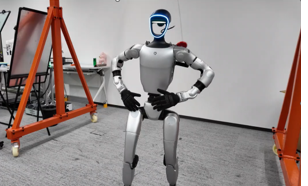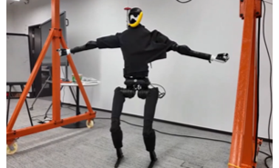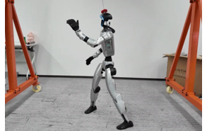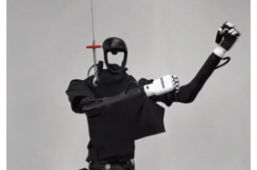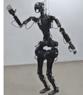</td></tr>
<tr><td align="center"><a href="docs/guides/locomotion.zh-CN.md#unitree_locounitree_rl_gym带步态">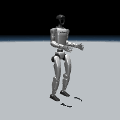</a><br><sub>unitree_loco</sub></td><td align="center"><a href="docs/guides/locomotion.zh-CN.md#smooth_loco">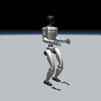</a><br><sub>smooth_loco</sub></td><td align="center"><a href="docs/guides/locomotion.zh-CN.md#amo_loco">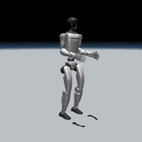</a><br><sub>amo_loco</sub></td><td align="center"><a href="docs/guides/motion_tracking.zh-CN.md#asap_tracker">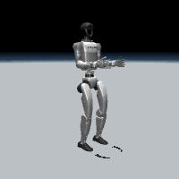</a><br><sub>asap_tracker</sub></td><td align="center"><a href="docs/guides/motion_tracking.zh-CN.md#beyondmimic_tracker">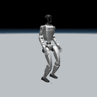</a><br><sub>beyondmimic_tracker</sub></td></tr>
<tr><td align="center"><a href="docs/guides/motion_tracking.zh-CN.md#twist_tracker">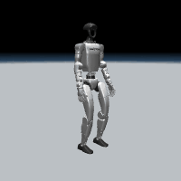</a><br><sub>twist_tracker</sub></td><td align="center"><a href="docs/guides/motion_tracking.zh-CN.md#kungfubot_tracker">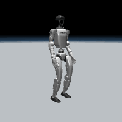</a><br><sub>kungfubot_tracker</sub></td><td align="center"><a href="docs/guides/motion_tracking.zh-CN.md#protomotions_trackerh2h">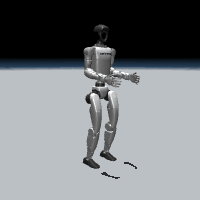</a><br><sub>protomotions_tracker</sub></td><td align="center"><a href="docs/guides/sonic.zh-CN.md#4-跟踪参考动作joint-模式"></a><br><sub>sonic</sub></td><td align="center"><a href="docs/guides/motion_tracking.zh-CN.md#supermimic">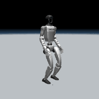</a><br><sub>supermimic</sub></td></tr>
<tr><td align="center"><a href="docs/guides/motion_tracking.zh-CN.md#blinkmimic"></a><br><sub>blinkmimic</sub></td><td align="center"><a href="docs/guides/motion_tracking.zh-CN.md#xmimic"></a><br><sub>xmimic</sub></td></tr>
</table>

<!-- controller-gallery:end -->

</div>


<!-- toc -->

<details>
<summary><b>目录</b></summary>

- [简介](#简介)
- [支持的控制器](#支持的控制器)
- [快速开始](#快速开始)
  - [单独运行一个控制器](#单独运行一个控制器)
  - [作为 hiRobot 机器人运行](#作为-hirobot-机器人运行)
  - [真机](#真机)
- [架构](#架构)
- [仓库结构](#仓库结构)
- [添加新控制器](#添加新控制器)
- [联系方式](#联系方式)
- [引用](#引用)
- [致谢](#致谢)
- [许可证](#许可证)

</details>

<!-- /toc -->

## 简介

hiWBC 是人形机器人底层的**全身控制**层。人形机器人不能开环接收关节目标，否则会摔倒。hiWBC 接收一条高层
运动命令（速度命令、参考动作或 motion latent）和机器人的当前状态，以机器人的实时控制频率输出保持平衡的
全身关节目标。

高层模型决定*做什么*；hiWBC 决定*全身如何运动*去完成它。各种学习得到的控制器，从速度命令的行走 policy、
参考动作跟踪器，到 SONIC 行为基础模型，都放在同一个接口约定之后，所以上层永远不用处理平衡、行走或厂商的
控制循环。

- **一个接口约定，多种控制器**：针对 `Controller` 接口约定编写控制循环，就能更换 policy（行走 policy、
  动作跟踪器），而不用改动机器人接口。
- **与命令来源无关**：同一个接口约定可以承载手柄的速度命令、来自动作播放器或 VR 遥操作的参考动作帧，
  或者来自 VLA 模型的 motion latent。命令从哪里来，不是控制器要关心的事。
- **参考进，关节目标出，作为 hiRobot 的一个 layer**：控制器就是
  `(state, reference) -> joint targets + gains`，一个不做硬件 I/O 的纯步进函数，所以任何循环都能运行它。
  通常用的是 hiRobot 的循环：在机器人配置中加上 `layers: [{type: wbc, profile: sonic/unitree_g1}]`，
  机器人接收的就不再是关节目标，而是基座速度、走到某个位姿的目标、手部位姿、motion token 和动作片段。
  这个 layer 以控制频率运行控制器，命令停止时站住，出现任何故障时让机器人进入阻尼。模型前向可以在工作站上
  运行，控制循环留在机器人上。
- **分步部署文档**：在真实人形机器人上部署全身控制器涉及许多新手猜不到的细节，所以
  [指南](docs/guides/README.zh-CN.md)覆盖了每个已发布的 policy：checkpoint 加载、关节顺序、训练时用的参数、
  增益和默认姿态、它需要的参考、在有支撑的情况下第一次上电，以及常见的坑。
- **解耦设计**：控制器平铺在 `controllers/` 中，每个文件一个，按名称注册；每个 checkpoint 训练时用的数值
  与代码分开，每个 `<controller>/<robot>` 一份 profile。模型前向是注入的，所以观测逻辑用一个桩函数测试，
  不需要权重；torch / onnxruntime 是可选的 extras，只在加载 checkpoint 的地方 import。已支持的 policy 的
  新 checkpoint 只是一个 profile 变体；新控制器是一个文件、它的 profile 和测试，layer 和 hiRobot 都无需改动。

> [!NOTE]
> **配套项目。** [hiRobot](https://github.com/humanoidintelligence/hiRobot)（身体）是 hiWBC 作为 layer
> 接入的机器人接口，[hiVLA](https://github.com/humanoidintelligence/hiVLA)（运动皮层）部署产生高层命令的
> VLA 模型，[hiAgent](https://github.com/humanoidintelligence/hiAgent)（agent 操作层）从上方驱动机器人；
> 它与 hiRobot 通信，从不直接与 hiWBC 通信。hiWBC 的 layer 和类型需要 hiRobot；控制器本身只 import numpy，
> 可以从任何循环中步进。

> [!WARNING]
> **状态：早期开发中。** API 尚不稳定，随时可能变动。
>
> **真机安全。** 受软件控制的机器人可能伤人，也可能损坏自身。在硬件上运行之前，请仔细阅读本仓库，以及
> hiRobot 中你的机器人的[设置指南](https://github.com/humanoidintelligence/hiRobot/tree/main/docs/setup)。
> [RoboJuDo](https://github.com/HansZ8/RoboJuDo) 部署的 policy（`unitree_loco`、`smooth_loco`、`amo_loco`、
> `asap_tracker`、`twist_tracker`、`beyondmimic_tracker`、`kungfubot_tracker`、`protomotions_tracker`）我们之前
> 已在真机上测试过；这次又在 MuJoCo 中把每个 hiWBC 控制器与 RoboJuDo 逐 tick 对比过。这一版本身，包括
> `sonic`、`supermimic`、`blinkmimic` 和 `wbc` layer，只在仿真中运行过。
> 先在仿真中调试到能用，再一步步转到真机：先只读，再把机器人吊在龙门架上用低增益
> 运行，急停放在手边，机器人够得着的范围内不站人。在硬件上，`wbc` layer 会先插值到控制器的默认姿态再交给
> 控制器，命令停止时保持站立，出现故障时进入阻尼（[指南](docs/guides/robot.zh-CN.md)）；这些都代替不了
> 龙门架和急停。

## 支持的控制器

内置控制器按它们接收的命令分组。每个控制器都复现其 policy 训练时的观测布局，遵循
[RoboJuDo](https://github.com/HansZ8/RoboJuDo) 中的部署代码。观测字段的顺序关系到安全：给 policy 喂一个
顺序被打乱的观测，它就会用垃圾数据指挥机器人，所以测试固定了每一种布局。

**速度命令行走**：`ReferenceKind.VELOCITY`，`value = [vx, vy, wyaw]`：

| 控制器 | Policy | 观测 |
| --- | --- | --- |
| `unitree_loco` | [unitree_rl_gym](https://github.com/unitreerobotics/unitree_rl_gym)（步态）/ [unitree_rl_lab](https://github.com/unitreerobotics/unitree_rl_lab)（`with_gait=False`） | 角速度、投影重力、命令、关节位置 / 速度、上一个动作、步态相位 sin/cos |
| `smooth_loco` | [Smooth Humanoid Locomotion](https://github.com/zixuan417/smooth-humanoid-locomotion) | 步态 sin/cos、命令、角速度、roll / pitch、关节位置 / 速度、上一个动作、特权 latent 槽位、本体感知历史 |
| `amo_loco` | [AMO](https://github.com/OpenTeleVision/AMO) | 速度加上基座高度和躯干 yaw / pitch / roll（`value` 有 7 个元素）；一个 adapter MLP、一个 demo 项、本体感知历史，以及由 25 帧本体感知组成的第二个输入。观测 23 个 G1 关节，驱动其中 15 个 |

**参考动作跟踪**：`ReferenceKind.MOTION_FRAMES`，各项放在 `frames` 中：

| 控制器 | Policy | 参考项（`frames`） |
| --- | --- | --- |
| `asap_tracker` | [ASAP](https://github.com/LeCAR-Lab/ASAP) | 无；动作固化在 checkpoint 中，由内部的相位时钟推进 |
| `twist_tracker` | [TWIST](https://github.com/YanjieZe/TWIST) | `mimic_target` |
| `beyondmimic_tracker` | [BeyondMimic](https://github.com/HybridRobotics/whole_body_tracking) | `command`、`motion_anchor_ori_b`，除非 `without_state_estimator=True`，否则还有 `motion_anchor_pos_b` 和 `base_lin_vel` |
| `protomotions_tracker` | [ProtoMotions](https://github.com/NVlabs/ProtoMotions) | `task_obs` |
| `kungfubot_tracker` | [KungfuBot / PBHC](https://github.com/TeleHuman/PBHC) | `anchor_ref_rot`、`next_step_ref_motion`、`future_motion_*`；模型有三个输入，所以 `observe` 返回一个 tuple |
| `supermimic` | SuperMimic，非官方复现（[supermimic_deploy](https://github.com/KyrieYoung926/supermimic_deploy)，Unitree G1） | `goal`：来自 `goal_features` 的 `(T, 68)` 未来目标帧；`SuperMimicController.from_bundle(assets_dir)` 加载 bundle 中的 `config.json` 和 `policy.onnx` |
| `blinkmimic` | [BlinkMimic](https://github.com/fuyichen0725/blinkmimic)（Unitree G1；`.pt`，或训练进单个动作的 `.onnx` 导出文件） | `goal`：`(10, 73)` 接下来的参考帧，以及 `ref_root_quat`；BlinkMimic 不发布权重，checkpoint 需要自己训 |
| `blinkmimic`（`xmimic` variant） | [XMimic](https://github.com/nico-bohlinger/xmimic)（Unitree G1；`.npz`），BlinkMimic 的 JAX 重写 | 同 `blinkmimic`；XMimic 也不发布权重 |

**通用 motion token**：`ReferenceKind.LATENT` 或 `ReferenceKind.MOTION_FRAMES`：

| 控制器 | Policy | 参考 |
| --- | --- | --- |
| `sonic` | [GEAR-SONIC](https://github.com/NVlabs/GR00T-WholeBodyControl)（Unitree G1；`default`、`low_latency`、`sonic_v1_1`） | `LATENT`：一个 64 维 motion token，例如来自 VLA。`MOTION_FRAMES`：用于 `g1`、`teleop`（VR 三点）或 `smpl` 编码器模式的未来帧，由编码器转成 token。`VELOCITY`：经过 NVIDIA 的行走 planner，可以附带手部目标 |

SONIC 由两个模型组成：编码器把参考映射为 motion token，解码器把 token 加上 10 个 tick 的本体感知历史映射为
关节动作。`sonic` 遵循 NVIDIA C++ 部署的观测布局，以及每个已发布 checkpoint 的 `observation_config.yaml`。
它为每个目标返回部署中的逐关节 PD 增益。`SonicController.from_onnx(decoder_path, encoder_path)` 加载已发布的
ONNX 文件（需要 `onnx` extra）。为了按速度命令行走，`sonic/unitree_g1` profile 像 NVIDIA 的部署一样，加入同一
发布中的运动学 planner（规划器）：planner 根据命令预测下半身的动作，SONIC 跟踪它。

跟踪器读取当前 tick 的参考项。`ClipPlayer`（`hiwbc.references`）把 hiRobot 的 `MotionClip` 转成 `sonic`、
`twist_tracker`、`supermimic` 和 `blinkmimic` 需要的这些项；ASAP 和 BeyondMimic 的 checkpoint，以及 BlinkMimic
的 ONNX 导出文件，把训练进去的动作作为行为（behavior）播放。`kungfubot_tracker` 和 `protomotions_tracker` 也接受动作片段：它们的 profile 用 hiRobot 的
运动学计算需要正向运动学的项（KungfuBot 的关键身体部位位置、H2H 的模仿观测）。

`echo` 是一个不依赖任何东西的桩，接受所有参考类型，返回默认姿态。它不需要模型就能端到端地检验接口约定。

[指南](docs/guides/README.zh-CN.md)展示了如何用已发布的 checkpoint 运行每个控制器：
[入门](docs/guides/getting_started.zh-CN.md)、[行走](docs/guides/locomotion.zh-CN.md)、
[动作跟踪](docs/guides/motion_tracking.zh-CN.md)、[SONIC](docs/guides/sonic.zh-CN.md)，以及
[把控制器作为 hiRobot 机器人运行](docs/guides/robot.zh-CN.md)。它们的参数在 MuJoCo 中与 RoboJuDo（SONIC：
NVIDIA 的 C++ 部署）逐 tick 对比检查过。

## 快速开始

核心依赖 numpy 和 hiRobot；如果 pip 找不到 hiRobot，先安装它。extras 补上 checkpoint 需要的依赖：

```bash
git clone https://github.com/humanoidintelligence/hiWBC.git && cd hiWBC
pip install -e .                 # 核心：接口约定 + 控制器
# extras：torch（TorchScript checkpoint）· onnx（ONNX checkpoint，例如 SONIC）· dev（pytest、ruff）
python -m pytest                 # policy 都是桩；不需要 GPU 或权重
```

先单独运行控制器，再在 MuJoCo 中把它作为 hiRobot 机器人运行，最后才转到硬件。

### 单独运行一个控制器

控制器是一个纯步进函数，所以不需要机器人也能运行。用一个桩前向函数（不需要权重）：

```python
import numpy as np
from hiwbc import ControllerState, Reference, ReferenceKind, make_controller

n = 12  # 关节数，按 policy 训练时的顺序
ctrl = make_controller(
    "unitree_loco",
    num_actions=n,
    default_pos=np.zeros(n),
    forward_fn=lambda obs: np.zeros(n, dtype=np.float32),  # 代替 checkpoint
)
state = ControllerState(
    dof_pos=np.zeros(n), dof_vel=np.zeros(n),
    base_quat=np.array([0.0, 0.0, 0.0, 1.0]),  # [x, y, z, w]
    base_ang_vel=np.zeros(3),
)
target = ctrl.step(state, Reference(kind=ReferenceKind.VELOCITY, value=np.array([0.5, 0.0, 0.0])))
target.position  # (12,) PD 位置目标
```

要运行训练好的 policy，传入一个包装 checkpoint 的前向函数。例如一个 TorchScript 导出：

```python
import torch

policy = torch.jit.load("policy.pt").eval()

@torch.no_grad()
def forward_fn(obs):
    return policy(torch.from_numpy(obs).unsqueeze(0)).squeeze(0).numpy()
```

ONNX runner 的用法相同。checkpoint 在磁盘上时，profile 会用 policy 训练时的数值完成上面所有这些：

```python
import hiwbc

ctrl = hiwbc.load("unitree_loco/unitree_g1", checkpoint_dir="RoboJuDo/assets/models/g1")
```

每个控制周期调用一次 `ctrl.step`（行走控制器默认 50 Hz），每个 episode 开始时调用 `ctrl.reset()`，清空动作
平滑缓冲、相位时钟和历史。实际使用时，这个循环由 `wbc` layer 替你完成，下一节会展示。

### 作为 hiRobot 机器人运行

在 hiRobot 的机器人配置中加一个 `wbc` layer，机器人接收的就是高层动作，而不是关节目标。下面的例子在 hiRobot 的
MuJoCo G1 上运行 SONIC。它需要 hiRobot 的 `sim` extra、`onnx` extra，以及放在 `~/.cache/hiwbc/sonic` 下的
SONIC checkpoint（见 [SONIC 指南](docs/guides/sonic.zh-CN.md)）。

```yaml
# g1_sonic.yaml：在 MuJoCo G1 上运行 SONIC
defaults: [robots/unitree_g1_mujoco_standing]   # G1 自由地站在地面上
assembly:
  parts:
    body:
      overrides:
        model:    # 从 SONIC 的站立姿态开始（G1 SDK 顺序）
          home: [-0.312, 0, 0, 0.669, -0.363, 0, -0.312, 0, 0, 0.669, -0.363, 0,
                 0, 0, 0, 0.2, 0.2, 0, 0.6, 0, 0, 0, 0.2, -0.2, 0, 0.6, 0, 0, 0]
sim:
  realtime: false
  ramp_seconds: 0.0
layers:
  - type: wbc
    profile: sonic/unitree_g1
    start_seconds: 0.0     # 没有启动插值：SONIC 从第一个 tick 起就保持平衡
```

```python
import numpy as np
from hirobot import Action, ControlMode, make_robot

robot = make_robot("g1_sonic.yaml")
robot.connect()
walk = Action(mode=ControlMode.BASE_VELOCITY, base_velocity=np.array([0.4, 0.0, 0.0]))
for _ in range(250):      # 50 Hz 下 5 秒；在仿真中每次发送推进一个 tick
    robot.send_action(walk)
robot.hold()              # 站住
robot.disconnect()
```

G1 在 5 秒内向前走约 1.5 m，然后站住。在真机上，layer 改为运行自己的控制线程：调用方持续发送命令，超过 0.5 秒
（`timeout_s`）没有命令时机器人站住。[机器人指南](docs/guides/robot.zh-CN.md)解释了这些设置，并覆盖每种模式、
故障、状态和远程推理。

### 真机

RoboJuDo 部署的 policy 我们之前已在真机上测试过，它们的 hiWBC 控制器在 MuJoCo 中与 RoboJuDo 逐 tick 一致；
这一版本身，包括 `sonic`、`supermimic`、`blinkmimic` 和 `wbc` layer，只在仿真中运行过。同样的 `layers:` 条目放进真机的
hiRobot 配置中，真机按 hiRobot 的
[设置指南](https://github.com/humanoidintelligence/hiRobot/tree/main/docs/setup)设置。在硬件上，`connect()`
会启动一个线程，以控制频率运行控制器，在命令之间也保持平衡。启动插值只是普通的 PD，不做平衡，所以在控制器接管
之前要让机器人留在龙门架上。[机器人指南](docs/guides/robot.zh-CN.md)覆盖了时序、layer 选项和远程推理；远程推理
把控制循环留在机器人上，只在工作站上运行模型前向。

## 架构

![hiWBC 架构：hiAgent（通过网络与 hiVLA 通信）调用 hiRobot 的 Robot；make_robot 把 hiWBC 的 WbcRobot 作为 wbc layer 放进栈中。WbcRobot 把命令（基座速度、动作片段、motion latent、笛卡尔目标、基座位姿、skill）转成参考，每个 tick 运行控制器（硬件上是一个线程，仿真中逐步推进），处理启动插值、命令超时和故障，并把手指等直通关节原样传递。Controller.step 依次运行 observe、forward（注入的 ONNX、TorchScript 或远程模型）和后处理，返回一个 JointTarget；hiwbc.load 根据 controller/robot profile 构建它，下面是 controllers/ 和 references/（ClipPlayer、行为）。可选的 python -m hiwbc.serve 在工作站上运行模型前向。WbcRobot 把所有关节的 PD 目标发给 hiRobot 的本体驱动，驱动与真机或 MuJoCo 通信；hiWBC 使用 hiRobot 的 register_layer、Action、Observation、DofMap、MotionClip 和运动学。](assets/architecture.png)

快速开始的两部分就是 hiWBC 的两部分。控制器只负责计算，不占有硬件。运行它的一方读取机器人、调用
`Controller.step`，再发出返回的关节目标。通常这一方是 `WbcRobot`，即 hiWBC 注册的 hiRobot layer，所以整个栈
保留了 hiRobot 的安全门，机器人输入输出也只有一个权威来源。

`WbcRobot` 位于 hiRobot 栈中机器人的 assembly（本体、手、摄像头和音频，所以它能看到每个关节）及其安全门之上。
它本身也是一个 `Robot`，所以它上面的调用方（例如 hiAgent）无需改动：调用方会在 `action_modes` 中看到新的条目
（`BASE_VELOCITY`、`MOTION_CLIP`……），发送这些动作，而不是关节目标。每个 tick，layer 读取机器人、构建参考、
调用 `Controller.step`，并通过它下面的安全门发送 PD 目标。

核心概念：

| 概念 | 职责 |
| --- | --- |
| `ControllerState` | 每个 tick 读取的本体感知：关节位置 / 速度、基座姿态（`[x, y, z, w]` 四元数）、基座角速度、可选的基座线速度。关节向量按控制器自己的关节顺序排列。 |
| `Reference` / `ReferenceKind` | 这个 tick 的命令。`VELOCITY` 在 `value` 中携带 `[vx, vy, wyaw]`，`MOTION_FRAMES` 在 `frames` 中携带命名的参考动作项，`LATENT` 在 `value` 中携带一个不透明的 motion latent。 |
| `JointTarget` | 控制器的输出：全身 PD 位置目标，可选地带有逐关节的 `kp` / `kd` 覆盖值。 |
| `Controller` | 基类。`step` 依次运行 `observe`（构建 policy 输入）→ `forward`（运行模型）→ 共享的后处理（EMA `action_beta` → 截断 → 缩放 → `+ default_pos`）。`accepts` 声明它处理哪些 `ReferenceKind`。 |
| `register_controller` / `make_controller` | 按名称的注册表；配置按名称选择控制器，无需 import 它的模块。 |
| Profile（`hiwbc.load`） | `<controller>/<robot>`：一个带有其 checkpoint 训练时所用关节顺序、增益和缩放的控制器，checkpoint 已加载。变体（variant）在一个 policy 已发布的多个 checkpoint 之间选择。 |
| `load_onnx_runner` / `load_torchscript_runner` | 把 checkpoint 文件变成控制器接收的 `forward_fn`。这是唯一 import torch 或 onnxruntime 的地方。 |
| `ClipPlayer` / 行为 | 把动作片段转成每个 tick 的参考；或者是训练进 checkpoint 的动作，用 `start_behavior` 启动。 |
| `WbcRobot`（`wbc` layer） | 一个在下层机器人上运行控制器的 hiRobot `Robot`：输入 hiRobot `Action`，每个 tick 输出 PD 目标，带有启动插值、命令超时、故障和状态。 |
| 远程前向（`runtime="remote"`，`python -m hiwbc.serve`） | 控制器在机器人上构建，它的模型调用发往工作站上的前向服务；错过截止时间的调用重复上一个目标，多次错过则进入阻尼。 |

## 仓库结构

<details>
<summary><b>显示目录树</b></summary>

```
hiWBC/
├── src/hiwbc/
│   ├── types.py             # ControllerState / Reference（+ ReferenceKind）/ JointTarget / BehaviorSpec
│   ├── controller.py        # Controller 接口约定：observe → forward → 后处理
│   ├── registry.py          # 按名称的控制器；profile：hiwbc.load("<controller>/<robot>")
│   ├── runtime.py           # load_onnx_runner / load_torchscript_runner（checkpoint -> forward_fn）
│   ├── robot.py             # WbcRobot：hiRobot 的 "wbc" layer
│   ├── plugin.py            # hirobot.drivers entry point：register_layer("wbc")
│   ├── remote.py            # 远程模型前向：RemoteFn、make_remote、传输格式
│   ├── serve.py             # python -m hiwbc.serve：前向服务
│   ├── math_utils.py        # 四元数 / 投影重力工具函数（纯 numpy）
│   ├── configs/             # 每个 <controller>/<robot> 一份 profile：训练时的数值 + checkpoint 加载
│   │   └── sonic/unitree_g1.py  # 例如 SONIC_G1（关节顺序 / 增益 / 动作缩放）+ 观测布局
│   ├── references/          # ClipPlayer：MotionClip -> 每个 tick 的参考（重采样、朝向、窗口）
│   └── controllers/         # 平铺：每个文件一个控制器
│       ├── echo.py          # 无依赖的桩：保持默认姿态
│       ├── unitree.py       # unitree_loco：速度命令行走
│       ├── smooth.py        # smooth_loco：带历史的速度命令行走
│       ├── amo.py           # amo_loco：速度 + 高度 / 躯干命令（AMO）
│       ├── asap.py          # asap_tracker：相位驱动的动作跟踪
│       ├── _tracker.py      # 下面四个跟踪器的共享基类
│       ├── twist.py         # twist_tracker
│       ├── beyondmimic.py   # beyondmimic_tracker
│       ├── protomotions.py  # protomotions_tracker
│       ├── kungfubot.py     # kungfubot_tracker
│       ├── supermimic.py    # supermimic：SuperMimic 跟踪器（非官方复现）
│       ├── blinkmimic.py    # blinkmimic：BlinkMimic / XMimic 跟踪器
│       ├── sonic.py         # sonic：SONIC 编码器 → motion token → 解码器（与机器人无关）
│       └── sonic_planner.py # SONIC 的行走 planner：速度命令 -> 参考动作
├── tests/                   # pytest 测试集；policy 都是桩，不需要 GPU 或权重
├── docs/
│   ├── guides/              # 分步指南，附完整示例，按控制器类别划分
│   └── api.md               # 公开 API 参考
├── assets/                  # README 图片
└── CHANGELOG.md             # 每个版本的变化（中文：CHANGELOG.zh-CN.md）
```

</details>

每个版本改了什么见 [CHANGELOG.zh-CN.md](CHANGELOG.zh-CN.md)。

## 添加新控制器

> [!TIP]
> **欢迎提交 pull request。** 新的控制器、面向另一台机器人或另一个 checkpoint 的 profile、与某个 policy 自己的
> 部署代码做的对齐检查，或修正一份指南，每一项都让多一个 policy 能在同一个接口约定之后部署。提交 pull request
> 之前，请阅读 [CONTRIBUTING.md](CONTRIBUTING.md)：每类改动需要什么，以及如何检查。

[API 参考](docs/api.zh-CN.md)逐项列出了每个控制器的构造参数和观测布局；[指南](docs/guides/README.zh-CN.md)
展示了它们如何接上真实的 checkpoint。

一个控制器由它构建的观测定义；前向和后处理来自基类。

1. **继承 `Controller`**：把 `accepts` 设为它处理的 `ReferenceKind`，并把 `num_actions`、`default_pos` 和动作
   后处理参数（`action_scale`、`action_clip`、`action_beta`）传给 `super().__init__`。训练时没有做动作平滑的
   policy 用 `action_beta=1.0`。
2. **实现 `observe`**：严格按 policy 训练时的顺序拼接观测项。多输入模型返回一个由数组组成的 tuple。
3. **实现 `forward`**：调用注入的 `forward_fn`。checkpoint 加载不要放进控制器，这样测试可以换成桩。
4. **注册**：在 `hiwbc/controllers/` 中的一个工厂函数上加 `@register_controller("<name>")`，并添加一个断言
   观测布局的测试。
5. **添加 profile**：在 `hiwbc/configs/<controller>/<robot>.py` 中写上 checkpoint 训练时用的关节顺序、增益、
   默认姿态和缩放，这样 `hiwbc.load("<controller>/<robot>")` 和 `wbc` layer 就能使用它。

## 联系方式

- [Peng Li](https://artpli.github.io): pengli.ds [at] gmail.com

## 引用

如果你在研究中使用了 hiWBC，请同时引用 hiWBC 和 RoboJuDo。hiWBC 建立在 RoboJuDo 的基础上：大部分内置控制器遵循
它的部署代码，并在 MuJoCo 中与它逐 tick 对比检查过。

```bibtex
@misc{hiwbc,
  title  = {hiWBC: A Unified Whole-Body Control Layer for Humanoid Robots},
  author = {Li, Peng and Zhuang, Zihan and Zhang, Yifei and Dong, Yi and Gui, Tao and Qiu, Xipeng},
  year   = {2026},
  url    = {https://github.com/humanoidintelligence/hiWBC}
}

@misc{RoboJuDo,
  title  = {A plug-and-play deploy framework for robots. Just deploy, just do.},
  author = {Zhuang, Zihan and Dong, Yi and Li, Peng},
  year   = {2025},
  url    = {https://github.com/HansZ8/RoboJuDo}
}
```

## 致谢

内置控制器的观测布局遵循 [RoboJuDo](https://github.com/HansZ8/RoboJuDo) 中每个 policy 的部署代码。`sonic`
控制器遵循 NVIDIA [GR00T-WholeBodyControl](https://github.com/NVlabs/GR00T-WholeBodyControl)（Apache-2.0）中的
C++ 部署。hiWBC 不附带 SONIC 权重；已发布的 checkpoint 采用 NVIDIA Open Model License。`supermimic` 控制器遵循
[supermimic_deploy](https://github.com/KyrieYoung926/supermimic_deploy)（MIT）的推理代码，hiWBC 同样不附带
SuperMimic 权重。`blinkmimic` 控制器遵循 [BlinkMimic](https://github.com/fuyichen0725/blinkmimic)（MIT）的 policy 代码，它的
`xmimic` variant 遵循 [XMimic](https://github.com/nico-bohlinger/xmimic)（MIT；Bohlinger 和 Peters，"XMimic and
XSoma: Learning Humanoid Motion Tracking and Locomotion in Under a Minute"，[arXiv:2611.20452](https://arxiv.org/abs/2611.20452)）。
两者都不发布权重，在 LAFAN1（CC BY-NC-ND 4.0）上训出的 policy 只能用于非商业用途。policy 本身来自
[支持的控制器](#支持的控制器)中链接的项目。

## 许可证

[Apache License 2.0](LICENSE)。完整条款见 [LICENSE](LICENSE)。
